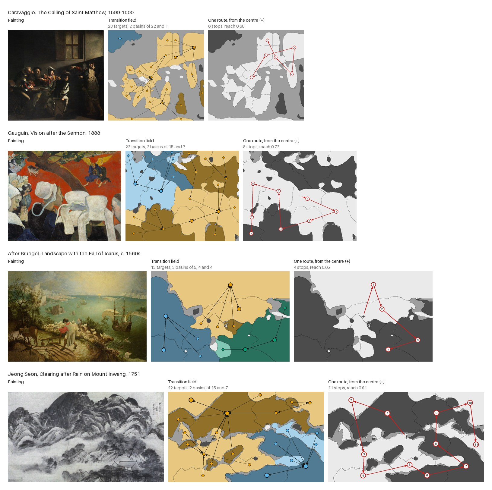
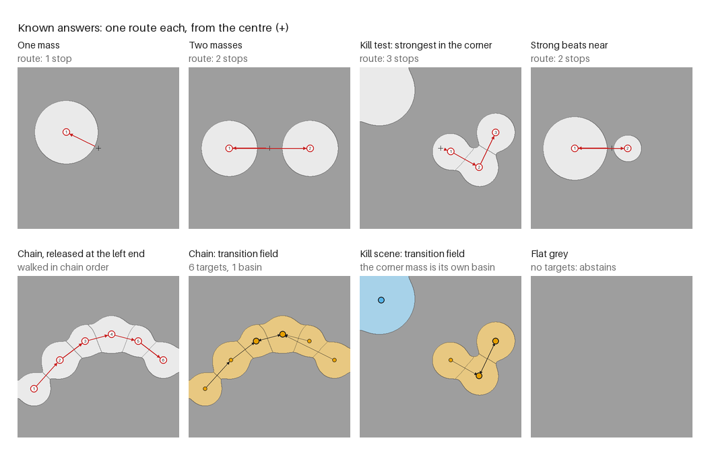
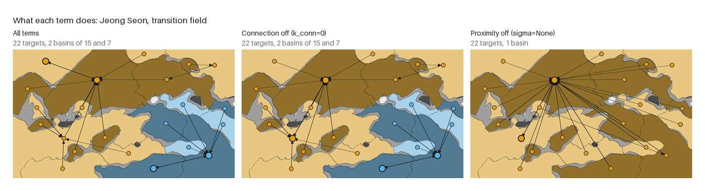

# notan-route

The order in which a picture's structure leads from one mass to the next, read from its Notan.



**Reading the figures.** Underneath is the picture's 3-value Notan: dark masses, flat ground (mid grey) and light masses, with thin lines where one target ends and the next begins. In the *transition field*, each target is tinted by the basin it drains into (one colour per basin, colour-blind safe), each arrow points from a target to the one it leads to next, and the larger ringed dots are where a basin ends: a pair that lead to each other, or a dead end. In the *route*, the red numbers are the stops in order, starting from the cross at the centre.

`notan-route` cuts a picture's Notan mass into light and dark masses and walks between them. From wherever it stands, it takes the next mass by three things: how strong the mass is, how near it is, and how much mass the straight path to it carries rather than flat ground. Released from every mass in turn, the walks form a **transition field**: which masses lead to which, and the groups (basins) the picture's masses drain into. A single route is one sample of that field.

- **Deterministic.** No randomness, no learned model, no recognition. The same image gives the same field, byte for byte.
- **Built on the public Notan mass** from [parallaxmetrology/notan](https://github.com/parallaxmetrology/notan), unchanged.
- **Known answers first.** Ten gates on synthetic scenes were written before the route was trusted, including a kill test against a plain strongest-first ranking. All pass.
- **What it is not.** The route is a property of the mass map and four parameters. It makes no claim about eyes, gaze, attention or the order in which anyone looks at a picture. Whether it matches any of those is an open, untested question.

## Install

```bash
pip install git+https://github.com/parallaxmetrology/notan-route
```

This installs `parallax-notan` from GitHub as well. Python 3.9 or later.

## Use

```python
from notan_route import read, route, transition_field

rd = read("painting.jpg")          # Notan mass, cut into targets (masses)
field = transition_field(rd)        # the main readout
field["basins"]                     # where the field drains, and which masses drain there
one = route(rd)                     # one route, from the centre of the frame
route(rd, start=3)                  # ... or from target 3, "strongest", or a point (x, y)
```

```bash
notan-route field painting.jpg               # JSON
notan-route route painting.jpg --start strongest
notan-route targets painting.jpg
notan-route draw painting.jpg -o route.png   # field and route side by side
```

Coordinates are centred on the frame and divided by its longest side, so distances mean the same thing across the frame: `x` runs from -0.5 to 0.5 on a landscape picture's width.

## What it computes

1. **Targets.** The Notan mass (`parallax_notan.notan_mass`) is cut at its own flat threshold (0.06) and split by polarity: darker or lighter than the picture's median tone, as in `parallax_notan.value_map`. Within one polarity, the mass is split again wherever it dips between two peaks by at least the same threshold, so two masses joined only by a blurred halo stay two. Pieces smaller than 0.5% of the frame are dropped; how many and what share of the mass they held is reported (`dropped`). A target's **strength** is its summed mass divided by the strongest target's.
2. **Connection** between two targets: along the straight segment between them, the mass divided by the weaker end's mass, clipped to 0..1 and averaged; and the longest stretch of flat ground on the segment. 1 means the mass never drops below the weaker end on the way; 0 means the way is flat ground.
3. **The route.** From the current stop, every unvisited target scores

   `strength x exp(-d^2 / 2 sigma^2) x (1 - k + k x connection) x damping`

   with `d` the distance, `sigma` 0.22 of the frame, `k` 0.5, and `damping` lowering targets within about 0.11 of a stop already taken. The best is taken; a tie goes to the stronger. The route ends when every target is taken or the best score is below 0.02 (the first stop is always taken). `reach` is the share of the mass the route visited.
4. **The transition field.** The route is released from every target (`releases`). Separately, the **successor** of each target is the best next target with no history. Following successors from any target ends in a **basin**: a pair of targets that are each other's successor, or a dead end (a target with no successor above the floor). Each basin reports its members and their share of the mass. `visitation` is the share of releases that reach a target; `entry_stability` is the mean overlap (Jaccard) of the sets of targets the releases visit, 1 meaning the same targets whatever the start.

A basin always ends in a pair or a dead end, never in a longer loop. For a successor `j` of `i` and a successor `k` of `j`, the pair weight `strength_j x strength_k x kernel_jk` is at least `strength_i x strength_j x kernel_ij`, because `i` was a candidate for `j` (the kernel, proximity times connection, is symmetric). The weight can only rise along a successor path, so the path settles on a pair that is mutually best. A loop of three or more would need exact ties.

`params()` lists the parameters; `route` and `transition_field` accept overrides (`sigma=None` turns proximity off, `k_conn=0` turns connection off).

## Known answers



`tests/test_gates.py`, written before the code was trusted:

| gate | scene | result |
|---|---|---|
| one mass: the route starts on it | one soft mass off centre | pass |
| two masses: both visited | two equal masses | pass |
| flat image: abstain | flat grey; also fine noise only | pass (no targets, `abstain: true`) |
| same input, same route | the kill scene, route and field | pass |
| **kill test**: departs from strongest-first | strongest mass in the far corner, three weaker near the centre, nearest weakest | pass: departure 1.00, the corner mass is never first |
| second control: not only nearest-first | a weak mass near the centre, a strong one a little farther | pass: the strong one is taken first |
| a chain is walked in chain order | six masses on an arc, mixed strengths, released at the left end | pass, and the order differs from strongest-first |
| a gap of flat ground lowers the connection | two masses with flat ground between; the same with a third mass between; the same moved closer | pass: bridged and closer both connect more, and the flat gap is longer |
| light and dark polarity kept | one light and one dark mass on mid grey | pass |

`tests/test_field.py`: two equal masses form one basin ending in their pair; the far corner mass in the kill scene is its own dead-end basin; an equal-strength chain is walked in order from both ends; each route from a target equals the field's release from that target; scalars stay in range and saturation is reported.

**What the kill test shows and what it does not.** On the kill scene the route from the centre is exactly a nearest-first tour (departure from nearest-first 0.00). The kill test alone therefore only shows that proximity matters; the second control shows that strength can override it. A documented behaviour (`test_mixed_chain_right_end_skips_the_weakest_link`): released from the right end of the mixed chain, the route jumps the weakest link (value 0.50) for the strongest one beside it (0.95), comes back along the chain, and the skipped link is then damped below the floor.

## The four paintings

From the figure at the top, and `notan-route field`:

| | targets | dropped mass | basins (members) | entry stability | centre route |
|---|---|---|---|---|---|
| Caravaggio | 23 | 2.8% | 2 (22, 1) | 0.56 | 6 stops, reach 0.60, starts on target 4 |
| Gauguin | 22 | 1.7% | 2 (15, 7) | 0.67 | 8 stops, reach 0.72, starts on target 5 |
| Bruegel | 13 | 0.5% | 3 (5, 4, 4) | 0.52 | 4 stops, reach 0.65, starts on the strongest |
| Jeong Seon | 22 | 0.4% | 2 (15, 7) | 0.80 | 11 stops, reach 0.91, starts on the strongest |

- **Caravaggio.** The median tone is dark, so most of the figure group and the lit wall are light mass. All but one target drain into a pair on the lit upper right; the one other basin is the dark upper-left corner, a dead end with no successor above the floor.
- **Gauguin.** Two basins split the picture left and right. One ends in a pair at the left edge, at the height of the women's bonnets there; the other in a pair on the large white bonnets in the foreground, lower centre and right.
- **Bruegel.** Three basins, one per large region: the light sky and sea, the dark land at the left, the dark lower right with the ship.
- **Jeong Seon.** Two basins: one ends on the dark mountain and the light sky at its upper left, the other on the dark woods at the lower right. The highest entry stability of the four: wherever the route starts, it visits much the same targets.

Across all releases, the mean departure from strongest-first order is 0.39, 0.37, 0.44 and 0.40 (0 = the same order, 1 = reversed). The centre routes depart from a nearest-first tour by 0.27, 0.25, 0.33 and 0.58. On these four pictures the route is neither a strength ranking nor a nearest-neighbour tour.

**Saturation.** Connection is clipped at 1 for 0.4% of target pairs on Caravaggio, 1.7% on Gauguin and none on the other two; no pair reads exactly 0. No painting reaches entry stability 1. Strength is 1.0 for target 0 by construction (`saturation` in the field output reports all of these).

### What each term does



| | releases changed with connection off | basins with connection off | basins with proximity off |
|---|---|---|---|
| Caravaggio | 9 of 23 | 1 (the dead end joins) | 1, ending on the two strongest |
| Gauguin | 5 of 22 | 2, same ends | 1, ending on the two strongest |
| Bruegel | 4 of 13 | 3, same ends | 1, ending on the two strongest |
| Jeong Seon | 15 of 22 | 2, one end changes | 1, ending on the two strongest |

Proximity makes the basins: without it every target leads to the strongest mass and the field has one basin. Connection changes individual routes (4 to 15 releases per painting) and, here, one basin end and one dead end. It does this through the history of a route (which stops are already taken), not the single next step: with connection off, only 0 to 2 targets per painting change their successor, which is why the field drawings above look almost the same. On these four paintings the basins are set almost entirely by strength and proximity.

### Stability

`python tools/stability.py`. A basin holds when, after the change, a basin ends at the same place (every end target's centroid within 0.05 of the frame's longest side). In brackets, basins that appear only after the change.

| painting | basins | crop 2% | JPEG 60 | gamma 0.8 | gamma 1.25 | half size |
|---|---|---|---|---|---|---|
| Caravaggio | 2 | 1/2 | 2/2 | 1/2 | 0/2 (+1) | 1/2 |
| Gauguin | 2 | 2/2 | 2/2 | 2/2 | 2/2 | 2/2 |
| Bruegel | 3 | 3/3 | 3/3 | 3/3 | 3/3 | 3/3 |
| Jeong Seon | 2 | 1/2 (+1) | 2/2 | 1/2 (+1) | 1/2 (+1) | 2/2 |

Gauguin and Bruegel hold under every change. On Caravaggio the dead-end corner basin disappears under the crop, gamma 0.8 and half size, and under gamma 1.25 the main basin keeps its upper-right end but changes its partner. On Jeong Seon one end pair moves under the crop and both gamma changes. Read basin ends on such pictures as one of nearby alternatives; basin membership is steadier than the exact pair.

## Operating window

- **Polarity is relative to the median tone.** On a dark picture "light" covers the mid-tones too (Caravaggio). This is Notan's reading, inherited unchanged.
- **Proximity sets the scale.** With `sigma` 0.22, masses more than about half the frame apart rarely lead to one another; a mass isolated by more than that becomes a dead end. The basins depend on `sigma` (proximity off gives one basin), so compare fields only at the same parameters.
- **The floor sets reach.** A route ends when nothing scores above 0.02, so a single route can leave a far mass unvisited (the kill scene's corner). The field, released from every target, does not have this blind spot.
- **Splitting.** A mass is split where its value dips by the flat threshold between peaks. A long mass with a soft dip in it becomes two targets; a mass whose peaks differ by less stays one.
- **Small marks are out of scope.** Pieces under 0.5% of the frame are dropped (the share of mass they held is reported). Small accents that a painter would count as structure are not targets here.
- **Resolution.** Everything is read at 512 pixels on the longest side, Notan's working size; smaller images are not enlarged.
- **Abstains** on images with no mass (flat, or texture that vanishes in the Notan squint) rather than inventing a route.

The checks follow [How image measures lie quietly](https://www.parallaxmetrology.com/how_measures_lie.html): a dead field abstains, near-zero chroma is handled by Notan's own guard, dropped small pieces are reported rather than hidden, bounded scores report their saturation, the connection's denominator is guarded, the controls' free parameters are shown by ablation, the field replaces a single draw, and nothing is random.

## Tests and figures

```bash
pip install -e ".[dev]"
ruff check .
pytest                                  # 16 tests, about 3 s
python tools/make_readme_images.py      # docs/images/
python tools/stability.py               # the stability table
python -m notan_route.scenes scenes/    # the known-answer scenes as PNGs with EXPECTED.json
```

## Paintings

All public domain: Caravaggio, *The Calling of Saint Matthew*, Contarelli Chapel, San Luigi dei Francesi, Rome. Paul Gauguin, *Vision after the Sermon*, Scottish National Gallery, Edinburgh. After Pieter Bruegel the Elder, *Landscape with the Fall of Icarus*, Royal Museums of Fine Arts of Belgium, Brussels. Jeong Seon, *Clearing after Rain on Mount Inwang*, National Museum of Korea, Seoul.

## Speed

The transition field releases a route from every target, so its cost grows quickly with the number of masses. The four paintings take well under a second each; a deliberately fragmented grid of 121 masses took about 5 seconds.

## License

Code: MIT ([LICENSE](LICENSE)). Documentation and figures: CC BY 4.0 ([LICENSE-CONTENT](LICENSE-CONTENT)). The paintings are public domain.

Russell Parrish / [Parallax Metrology](https://www.parallaxmetrology.com)
